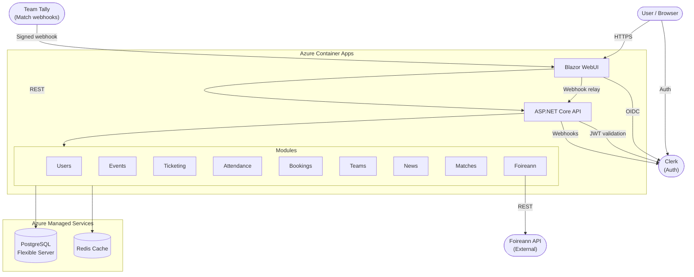
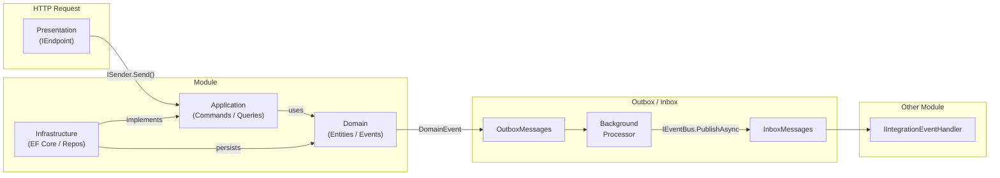

# Silverbridge Harps GFC Website

The official website for Silverbridge Harps GFC — a GAA club in County Armagh. The application handles event management, ticketing, attendance tracking, news, bookings, and club administration.

## Tech Stack

| Layer         | Technology                        |
| ------------- | --------------------------------- |
| Runtime       | .NET 10                           |
| Backend API   | ASP.NET Core Minimal APIs         |
| Frontend      | Blazor Interactive Server (MudBlazor UI) |
| Database      | PostgreSQL (per-module schemas)   |
| Cache         | Redis                             |
| Auth          | Clerk (JWT / OpenID Connect)      |
| Hosting       | Azure Container Apps              |
| Orchestration | .NET Aspire                       |

## Prerequisites

- [.NET 10 SDK](https://dotnet.microsoft.com/download)
- [Docker Desktop](https://www.docker.com/products/docker-desktop/) (for local containers via Aspire)
- A [Clerk](https://clerk.com) account with an application configured

## Getting Started

```bash
# Restore dependencies
dotnet restore

# Run locally with Aspire (spins up PostgreSQL, Redis, API, and WebUI)
dotnet run --project src/Aspire/SilverbridgeWeb.AppHost
```

The Aspire dashboard will open automatically. pgAdmin is available at `http://localhost:5050`.

### Required Parameters

The following parameters must be set before running (via `appsettings.Development.json` or environment variables):

| Parameter                      | Description                         |
| ------------------------------ | ----------------------------------- |
| `clerk-authority`              | Your Clerk issuer URL               |
| `clerk-webhook-signing-secret` | Clerk webhook signing secret        |
| `team-tally-webhook-signing-secret` | Team Tally webhook signing secret |
| `clerk-client-id`              | Clerk OIDC client ID (frontend)     |
| `clerk-client-secret`          | Clerk OIDC client secret (frontend) |
| `foireann-primary-api-key`     | Foireann API primary key            |
| `foireann-secondary-api-key`   | Foireann API secondary key          |

## Build & Test

```bash
# Build
dotnet build

# Build (Release)
dotnet build --configuration Release

# Run all tests
dotnet test

# Frontend component tests
dotnet test src/Frontend/test/SilverbridgeWeb.WebUI.ComponentTests

# Frontend browser tests
dotnet test src/Frontend/test/SilverbridgeWeb.WebUI.BrowserTests

# Architecture tests only
dotnet test test/SilverbridgeWeb.ArchitectureTests

# Tests for a specific module
dotnet test src/Backend/Modules/Users/test/SilverbridgeWeb.Modules.Users.ArchitectureTests
```

## Architecture

The application is a **modular monolith** with a vertical slice architecture inside each module, deployed as a single container to Azure Container Apps.

### Frontend design system

The WebUI uses a custom MudBlazor theme based on Silverbridge blue (`#263C9F`) and yellow (`#FCCF02`). Light and dark modes follow the user's system preference by default, with a locally persisted manual override.

- Theme tokens and palettes: `src/Frontend/SilverbridgeWeb.WebUI/Theme/`
- Shared page patterns: `src/Frontend/SilverbridgeWeb.WebUI/Components/Shared/`
- Global foundations: `src/Frontend/SilverbridgeWeb.WebUI/wwwroot/css/app.css`
- Page-specific responsive styling: scoped `.razor.css` files

New pages should use `PageHeader`, `SectionHeader`, and `StatePanel`, provide one semantic `h1`, preserve visible keyboard focus, and remain usable from 320px wide without horizontal scrolling.

### System Overview



### Module Internal Architecture

Each module is internally structured with Clean Architecture layers. Commands and queries flow through CQRS, and cross-module communication happens exclusively through integration events via an outbox/inbox pattern.



### Modules

| Module         | Responsibility                             |
| -------------- | ------------------------------------------ |
| **Users**      | User management and authentication         |
| **Events**     | Event creation and management              |
| **Ticketing**  | Ticket sales and management                |
| **Attendance** | Attendance tracking                        |
| **Bookings**   | Facility and resource bookings             |
| **Teams**      | Team management                            |
| **News**       | News and announcements                     |
| **Matches**    | Completed match capture from Team Tally    |
| **Foireann**   | Integration with the Foireann GAA platform |

### Module Layer Structure

Each module follows **Clean Architecture** with layer dependencies enforced by architecture tests:

```
Module.Domain/              # Entities, value objects, domain events
Module.Application/         # Commands, queries, handlers, validators
Module.Infrastructure/      # EF Core DbContext, repositories, outbox/inbox
Module.Presentation/        # Minimal API endpoints (IEndpoint)
Module.IntegrationEvents/   # Events shared with other modules
Module.ArchitectureTests/   # NetArchTest layer boundary rules
```

**Dependency rules**: Domain ← Application ← Infrastructure, Presentation

### CQRS

All operations go through a custom `ISender` (backed by `MessageDispatcher` in `Common.Application`):

- Commands modify state and return `Result<T>`
- Queries read state and return `Result<T>` or data
- Handlers live in the `Application` layer
- Validation via `FluentValidation`

### Cross-Module Communication

Modules are isolated — they never reference each other directly. Communication uses **integration events**:

1. Aggregate raises a domain event
2. Domain event handler publishes an integration event via `IEventBus`
3. Target module consumes it via `IIntegrationEventHandler<T>` through the inbox pattern

**Outbox**: domain events → `OutboxMessages` table → background processor → `IEventBus.PublishAsync`  
**Inbox**: integration events → `InboxMessages` table → idempotent `IIntegrationEventConsumer<T>`

### Database

Each module owns its own PostgreSQL schema (e.g. `users`, `events`, `ticketing`). Migrations are per-module under `Module.Infrastructure/Database/Migrations/`.

### Team Tally webhooks

Configure Team Tally to POST `match.completed` events to
`https://silverbridgeharps.club/webhooks/team-tally`. The public WebUI forwards the
unchanged payload and `TeamTally-Signature` header to the private API at
`matches/webhooks/team-tally`. The relay does not forward browser credentials or
retry deliveries; Team Tally owns delivery retries. Both hops enforce a 1 MiB
body limit, including requests without a content length.

The API authenticates the raw body before parsing it. The signature contract is
`TeamTally-Signature: t=<Unix seconds>,v1=<Base64 signature>`, where the signature
is HMAC-SHA256 over the UTF-8 timestamp, a literal `.`, and the original body bytes,
using the raw UTF-8 signing secret. Timestamps must be within five minutes of the
server clock in either direction. JSON reformatting changes the signature.
The JSON event ID is independent of the signature timestamp. An old sample
timestamp must be replaced and signed again when testing a delivery.

Set the secret in the AppHost's local user secrets as
`Parameters:team-tally-webhook-signing-secret`; Aspire supplies it only to the API
as `TeamTally__WebhookSigningSecret`. For production, configure the
`ASPIRE_TEAM_TALLY_WEBHOOK_SIGNING_SECRET` GitHub environment secret, which the
deployment workflow passes to Aspire. Never put the value in module JSON files.
Missing configuration fails validation rather than accepting unsigned requests.
Before activating production deliveries, check a real Team Tally signed delivery
against this contract and confirm the provider's retry policy.

The Matches module owns `matches.match_completions`. It stores a queryable
snapshot of match metadata and both team/opponent scores, provider IDs/version,
three distinct timestamps (provider event creation, match end, server receipt),
and the original JSON, including extra fields. The **first verified, valid
completion per Team Tally match wins**. Repeated deliveries, even with different
event IDs or changed scores, return success without another row, overwrite, or
event. Reusing an event ID for a different match is a conflict. Compatible
payload versions are accepted without a version-date whitelist.

Invalid signatures return 401, malformed completed-match payloads or fields
exceeding storage limits return 400,
oversized requests return 413, and storage failures return a non-success response.
Verified unsupported events, including `result.amended`, are logged and
acknowledged without storage. Amendments, local team/coach mapping, player
statistics, UI, and automatic News creation are not implemented.

The completion and its domain outbox event commit together before returning 200.
The Matches outbox publishes `MatchCompletedIntegrationEvent` with a stable ID
and typed snapshot, without the original JSON. Delivery is **at-least-once**:
future consumers must be idempotent. The in-process event bus succeeds when no
consumer is registered; adding a subscriber later does not deliver historical
events automatically. Persisted completions are the source for a future explicit
backfill.

Matches-only outbox settings live in `modules.matches.json`. Failed publication
uses persisted exponential backoff and **five total attempts**. Successful
messages get `processed_on_utc`; exhausted messages remain unprocessed with
`exhausted_on_utc` and their latest `error`. Logs identify failed/exhausted message
IDs without logging webhook payloads or secrets. Existing modules' outbox
behavior is unchanged. Inspect exhausted messages in PostgreSQL:

```sql
SELECT id, attempt_count, exhausted_on_utc, error
FROM matches.outbox_messages
WHERE exhausted_on_utc IS NOT NULL
ORDER BY exhausted_on_utc;
```

After resolving the failure, replay one explicitly identified message:

```sql
UPDATE matches.outbox_messages
SET attempt_count = 0,
    next_attempt_on_utc = NULL,
    exhausted_on_utc = NULL,
    error = NULL
WHERE id = '<message UUID>'
  AND processed_on_utc IS NULL
  AND exhausted_on_utc IS NOT NULL;
```

Keep its original ID/content and successful `matches.outbox_message_consumers`
markers. A crash between publication and committing retry state may cause
redelivery; a database outage may prevent recording an attempt.

Focused validation (PostgreSQL integration tests require a running Docker engine):

```powershell
dotnet test src\Backend\Modules\Matches\test\SilverbridgeWeb.Modules.Matches.UnitTests
dotnet test src\Backend\Modules\Matches\test\SilverbridgeWeb.Modules.Matches.IntegrationTests
dotnet test src\Backend\Modules\Matches\test\SilverbridgeWeb.Modules.Matches.ArchitectureTests
dotnet test src\Frontend\test\SilverbridgeWeb.WebUI.ComponentTests --filter "FullyQualifiedName~WebhookRelayTests"
dotnet test test\SilverbridgeWeb.ArchitectureTests
```

### Common Projects

| Project                 | Contents                                               |
| ----------------------- | ------------------------------------------------------ |
| `Common.Domain`         | `Result`, `Error`, `Entity`, `DomainEvent`             |
| `Common.Application`    | `ICommand`, `IQuery`, handlers, `ISender`, `IEventBus` |
| `Common.Infrastructure` | Auth, caching, outbox/inbox, `EventBus` implementation |
| `Common.Presentation`   | `IEndpoint`, endpoint registration helpers             |

## Project Structure

```
src/
  Aspire/
    SilverbridgeWeb.AppHost/        # Aspire orchestration host
    SilverbridgeWeb.ServiceDefaults/ # Shared Aspire service defaults
  Backend/
    API/SilverbridgeWeb.Api/        # API entry point
    Common/                         # Shared Common.* projects
    Modules/                        # Feature modules
  Frontend/
    SilverbridgeWeb.WebUI/          # Blazor WebUI
    test/                           # Component and browser UI tests
test/
  SilverbridgeWeb.ArchitectureTests/ # Global architecture rules
```

## Deployment

The app is deployed to **Azure Container Apps** using the Aspire CLI:

```bash
aspire deploy --apphost ./src/Aspire/SilverbridgeWeb.AppHost/SilverbridgeWeb.AppHost.csproj
```

The production GitHub Actions workflow deploys on pushes to `main` and can also be started manually. It authenticates to Azure with OIDC and supplies deployment settings and secrets to `aspire deploy`.

The WebUI custom domain (`silverbridgeharps.club`) and its existing Container Apps environment certificate (`silverbridgeharps.club-silverbr-260913213917`) are configured on the WebUI resource in the AppHost. Aspire reapplies this binding on deployment. The certificate must already exist in the target Container Apps environment, and the domain's DNS records and ownership validation must remain configured in Azure.

## Key Conventions

- **IDs**: ULID stored as `Guid` — `Ulid.NewUlid().ToGuid()`
- **Namespaces**: match folder structure — `SilverbridgeWeb.Modules.{Module}.{Layer}.{Feature}`
- **Warnings as errors**: all projects — fix warnings before committing
- **Central Package Management**: all NuGet versions in `Directory.Packages.props`
- **No cross-module project references**: use integration events instead
